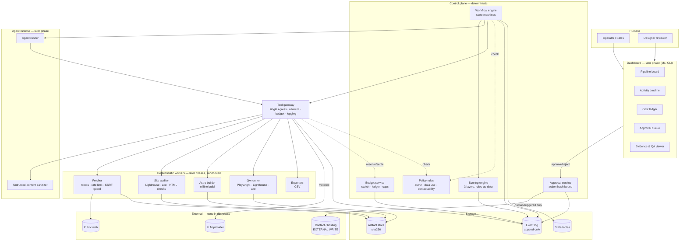
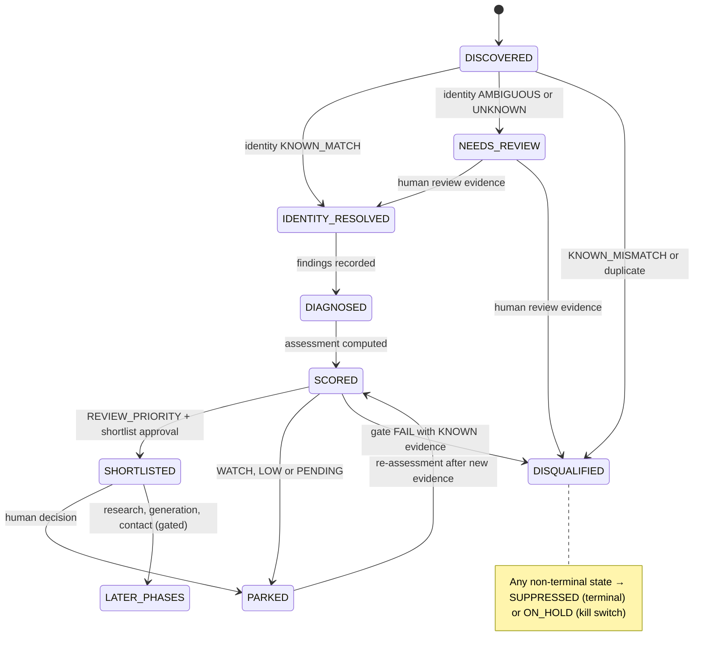

# Web Agency OS — Architecture

Revision: Phase 0, corrected after the Phase 0 review ([phase0-review.md](phase0-review.md)). Date: 2026-10-19.
Status: **design only — nothing is implemented.** M1 implementation is not yet authorized (PD-01 in
[decisions.md](decisions.md#pending-decisions)).

Related: [agent-design](agent-design.md) · [data-contracts](data-contracts.md) ·
[security-and-compliance](security-and-compliance.md) · [quality-gates](quality-gates.md) · [roadmap](roadmap.md) ·
[decisions](decisions.md).

Status labels (**VERIFIED**, **REPORTED**, **HYPOTHESIS**, **PENDING**) are defined in
[decisions.md § Status labels](decisions.md#status-labels). Numeric values marked `P-xx` are provisional parameters
listed in [decisions.md § Provisional parameters](decisions.md#provisional-parameters).

---

## 1. Workspace and Git state found

| Item | Finding | Status |
|---|---|---|
| `web-agency-os` | Git repository created empty; Phase 0 added documentation only. | VERIFIED |
| `aangelrvss-oss/OI` `main` | One commit `cab9f5e` (2026-10-09) containing only a one-line `README.md` (`# OI`). | VERIFIED |
| `aangelrvss-oss/OI` branch `claude/zealous-archimedes-qb70kr` | The real implementation. Head `19aeeb8`, parent `f66f674`, both 2026-10-09. 218 files: `oi/`, `core/`, `rules/`, `cases/`, `tests/`, `docs/`. Self-described public edition with synthetic data replacing pilot data. | VERIFIED |
| OI private copy | Referenced by OI's docs (601/601 tests, pilot data). Not available. | PENDING |
| Local OI workspace | None found besides the read-only clone made for the audit. | VERIFIED |

OI was inspected through a read-only clone and static reading. **No OI code was executed.** No OI branch, commit or remote
was modified. OI's test figures (`tests/LAST_RUN.json`: 371 run, 0 failures, 15 skipped) are OI's own committed record
and were **not reproduced**.

## 2. Opportunity Intelligence (OI): read-only audit

### 2.1 What OI is (VERIFIED by static reading)

A contract-driven B2B research engine: natural-language need → validated *Search Spec* → budgeted *Research Plan* →
discovery → entity resolution → cheap gates → enrichment → evidence → qualification → contact selection →
`opportunity_record.v1` → HTML report. Python 3, standard library only (a static import scan found no third-party imports
in `oi/`).

| Stage | Module | OI's own status label |
|---|---|---|
| Spec | `oi/engine/spec/` (deterministic local interpreter, no LLM) | partial / implemented |
| Plan + budget | `oi/engine/planner/` | implemented |
| Discovery/executor | `oi/engine/executor/`, `oi/pipeline/guard.py` — offline (synthetic) and replay transports; real mode always raises `RealModeBlocked` | partial |
| Entity resolution | `oi/engine/evaluators/` (4-state identity, no fuzzy matching) | implemented |
| Qualification | `oi/qualification/qualifier.py` + `rules/qualification.v1.json` | implemented |
| Evidence | `evidence_input.v1`, `oi/evidence/` — no real first-party evidence producer | partial |
| Scoring | `oi/rules/d010/` — not wired into the pipeline | partial |
| Project opportunities | `core/project_opportunity.py` v0.1 — not wired to the CLI | partial |
| Contact | `oi/enrichment/contact/` with anti-invention checks | partial |
| Approval | `oi/pipeline/approval.py` — offline auto-approval scoped to dry execution | implemented (offline) |
| Outcome loop / CRM / sending | — | not implemented |

"Implemented" above is OI's own label; it was not confirmed by running OI.

### 2.2 What WAOS reuses: designs, not code

No OI code is imported or integrated in this phase (D-001, D-019). WAOS re-implements the following ideas:

| OI design | Use in WAOS |
|---|---|
| Truth vocabulary `KNOWN · INFERRED · ESTIMATED · UNKNOWN · CONFLICTING`; "UNKNOWN ≠ PASS" | Adopted verbatim (M1) |
| `source_class` taxonomy | Adopted and extended (`MEASUREMENT`, `PUBLIC_REGISTRY`, `HUMAN_REVIEW`) (M1) |
| `evidence_strength` derived by ordered rules; reliability of a datum ≠ commercial usefulness | Adopted (M1) |
| `KNOWN` needs URL + literal snippet; never from a search-result snippet; contact values must appear literally | Adopted as evidence invariants (M1) |
| Budget concepts: no budget → `BUDGET_REQUIRED`; separate dimensions; costs only from observed/declared prices; hard cap ≠ authorization | Adopted in simplified form (M1) |
| Single egress module + offline socket lock + double authorization switch (`guard.py`) | Adopted as the M1 tool gateway pattern |
| Tool-call ledger fields | Adopted in the M1 `LedgerEntry` |
| Rules-as-data with version and hash; "score is not a probability" | Adopted (M1) |
| D010 unit IDs, Search Spec, planner routing, Apollo adapter, HTML renderer | Not reused |

**Pilot learnings** (aggregate figures from OI's README, not reproducible from the public edition): provider-based
discovery was noisy for a niche; the measured bottleneck was first-party evidence production; human pre-review improved
results on a small, non-random sample. These are OI's reported results, not verified here.

### 2.3 Inconsistencies found in OI (VERIFIED, out of scope to fix)

1. Two `source_class` vocabularies (`common.v1.schema.json` with 6 values; `core/project_opportunity.py` with 8).
2. The implementation is on an unmerged branch; any future integration must pin a commit SHA.
3. D010 and `core/project_opportunity` are not connected to OI's pipeline.
4. OI has no LLM integration and no real transport.

## 3. Principles

1. **Deterministic control plane.** Code validates, authorizes, budgets and transitions state. In later phases, agents
   (LLM calls) only *propose*.
2. **Evidence before generation.** Every claim about a business or a website is an `EvidenceRecord` with a source and a
   truth state.
3. **Three layers, never merged.** Technical evidence, acquisition impact and commercial opportunity are separate; none
   of them is purchase intent (§5.2, D-021).
4. **Event log for observability.** Every action is an append-only event written by the component that performed it.
5. **Least privilege, single egress.** One gateway is the only path to tools; in M1 no tool reaches the network.
6. **Untrusted input stays data.** External content is never interpreted as instructions.
7. **Human approval** for anything outward-facing or above budget. Outward-facing actions do not exist in this phase.

## 4. Target architecture (long term)

### 4.1 Phase status of each component

| Component | M1 | Later | Notes |
|---|---|---|---|
| Contracts + validator | ✔ | | 8 core contracts (data-contracts § 0) |
| Evidence module (invariants, strength rules) | ✔ | | |
| Scoring engine (three layers, rules-as-data) | ✔ | | |
| Lead state machine (subset) | ✔ | full machine later | §5.4 |
| Event log (SQLite, append-only) | ✔ | PostgreSQL if needed | §6 |
| CLI approvals bound to action hash | ✔ | dashboard approvals later | |
| Budget ledger + paid-call switch (off) | ✔ | hierarchical budgets later | §9 |
| Tool gateway (fake tools only, network locked) | ✔ | real tools later | |
| Safe CSV export | ✔ | XLSX later; Google Sheets excluded | |
| Retention / erasure / suppression commands (synthetic data) | ✔ | | Data-protection tests |
| Fetcher, sanitizer, site auditor | | M2a (fixtures) / M2b (real, gated) | |
| Job queue, PostgreSQL | | when concurrency requires | D-011 |
| Dashboard | | M3 | D-004 |
| Agent runner, LLM agents | | M5+ | agent-design |
| Astro builder, QA runner | | M6+ | quality-gates |
| OI bridge | | deferred | D-001 |
| AgentScope | | excluded this phase | D-005 |

### 4.2 Component diagram (target state)



Text fallback:

```
Operator ──► CLI (M1) / Dashboard (later) ──► Approval service (bound to action hash)
                         │
                         ▼
Workflow engine ──► Scoring engine (3 layers)        Event log ◄── every component writes its own events
      │
      └──► Tool gateway ──► fake tools (M1) / workers, LLM, public web (later, gated)
               ├─ policy check
               └─ budget: paid-call switch OFF, ledger
```

### 4.3 Component responsibilities

| Component | Responsibility |
|---|---|
| Workflow engine | Owns the state machines (§5.4). Only component that writes lead state. Every transition checks a guard and writes the state change and its event in one transaction. |
| Policy rules | Plain functions with rules in versioned JSON: which tool may be called, which data may be exported, contactability (later). Not a generic engine. |
| Budget service | Paid-call switch (two independent settings, both must be on), price table, ledger, caps. In M1 the switch is off and all tools are free fakes. |
| Approval service | Records a human decision bound to the SHA-256 of the exact action; executes the action at most once. In M1, actions are internal only. |
| Scoring engine | Computes the three-layer assessment from evidence with versioned rules. No LLM. |
| Tool gateway | Single path to any tool; allowlist, argument validation, budget check, ledger row and event per call. In M1 tools are fakes and the network is blocked in tests. |
| Event log | Append-only record of what the program did (§6). |
| Workers, agent runtime, dashboard, builder, QA | Later phases (see roadmap). |

### 4.4 Technology baseline

| Concern | Choice | Status |
|---|---|---|
| Language | Python | Accepted for M1 (D-010); version PENDING (PD-04) |
| Storage | SQLite | Accepted for M1 (D-011) |
| Test and schema libraries | stdlib only, or `pytest` + `jsonschema` | PENDING (PD-02) |
| Build/QA toolchain (later) | Node.js worker: Astro, Playwright, Lighthouse (Node API), axe-core | Proposed; versions REPORTED; admission review required |
| Agent framework (later) | In-house runner first | Proposed; AgentScope excluded this phase |
| LLM provider, discovery sources, hosting | — | PENDING |

### 4.5 Interface to OI (deferred)

When approved, WAOS would export `EvidenceRecord`s as OI `evidence_input.v1` and import OI `opportunity_record.v1` as
leads, through validated JSON files, with OI schemas vendored and pinned by commit SHA. Not built in this phase.

## 5. Business workflow

### 5.1 Stages (target)

| # | Stage | Main question | Who does the work | Phase |
|---|---|---|---|---|
| 1 | Discovery | Which businesses exist in the target area/category? | Operator CSV first; approved sources later | M1: synthetic fixtures; real: M4 (gated) |
| 2 | Identity | Is this one real business with a stable key? | Deterministic, 4-state | M1 |
| 3 | Diagnosis | Which technical problems are measurable? Which basic site facts (phone link, address, structured data) are present? | Deterministic auditor + deterministic fact extractor (fixes E2) | M1: fixtures; M2a: local test sites; M2b: real (gated) |
| 4 | Assessment | Technical evidence → acquisition impact → commercial opportunity (§5.2) | Scoring engine | M1 |
| 5 | Human review | Is this worth a proposal? | Operator (shortlist approval) | M1 (CLI) |
| 6 | Research | What does the business do; what proof exists? | Research agent (later) or human | Later |
| 7 | Strategy, creative, generation | Scope, copy, visuals, preview | Agents + deterministic Astro build | Gated (D-020) |
| 8 | QA | Measurable gates | QA runner + human design review | Factory phase |
| 9 | Sales preparation | Diagnostic summary, proposal, call script | Agent drafts; nothing is sent | Gated |
| 10 | Contact and CRM | Lawful contact, outcomes, suppression | Human | Gated (legal review) |
| 11 | Delivery | Signed client → site → publication | Human-led | Gated |

### 5.2 Three layers and contactability (D-021, D-023)

| Layer | Question | Produced by | Truth status allowed | Example |
|---|---|---|---|---|
| 1. Technical evidence | Does the problem exist and is it reproducible? | Measurements → findings | `KNOWN` for direct measurement; `INFERRED` for weak signals | "LCP 5.2 s, median of 3 lab runs, tool X version Y, date Z" |
| 2. Acquisition impact | Could this problem plausibly affect how customers find or contact the business? | Versioned rule table `impact_rules.v1` | Always `INFERRED` (it is a hypothesis about effect, H-4) | "No phone link on mobile: impact hypothesis HIGH" |
| 3. Commercial opportunity | Is this lead worth a human's review for a possible proposal? | Gates + business signals + layer 2 + contraindications | Bucket; never a probability | `REVIEW_PRIORITY` |
| — Purchase intent | Does the business want to buy? | **Only** a human recording an interaction with the prospect | `UNKNOWN` by default; no automated component may set it | Out of scope in M1 |
| — Contactability | May we contact this business, by which channel? | Policy rules + legal review | Separate from the score | Out of scope (D-020) |

Consequences: a high technical score alone can never produce `REVIEW_PRIORITY`; exports and CLI output label the bucket
as "priority for review", never as interest or intent.

### 5.3 Generation tiers (target; all gated by D-020)

| Tier | Artifact | Entry condition | Relative cost |
|---|---|---|---|
| T0 | Internal diagnosis summary | Identity `KNOWN_MATCH`; diagnosis recorded | HYPOTHESIS: lowest (H-8) |
| T1 | Concept card (one screen) | Lead `SHORTLISTED` (bucket `REVIEW_PRIORITY` + human shortlist approval) + approval of the T1 action | HYPOTHESIS (H-8) |
| T2 | One-page private preview | T1 done + human approval + quota (P-24) + per-lead budget; whether the prospect must have requested it is PENDING (PD-21) | HYPOTHESIS (H-8) |
| T3 | Full site | Signed engagement | Client project |

### 5.4 Lead state machine

**Target machine** (later phases add research, generation, contact and outcome states):



**M1 transition table** (normative for M1; every pair not listed is rejected):

| From | To | Guard |
|---|---|---|
| `DISCOVERED` | `IDENTITY_RESOLVED` | identity `KNOWN_MATCH` |
| `DISCOVERED` | `NEEDS_REVIEW` | identity `AMBIGUOUS` or `UNKNOWN` |
| `DISCOVERED` | `DISQUALIFIED` | identity `KNOWN_MISMATCH` or duplicate `entity_key` |
| `NEEDS_REVIEW` | `IDENTITY_RESOLVED` / `DISQUALIFIED` | a `HUMAN_REVIEW` evidence record resolving identity |
| `IDENTITY_RESOLVED` | `DIAGNOSED` | ≥ 1 finding set recorded (fixtures in M1) |
| `DIAGNOSED` | `SCORED` | a score record computed with the current rules hash |
| `SCORED` | `SHORTLISTED` | bucket `REVIEW_PRIORITY` **and** a valid `SHORTLIST` approval for that exact action |
| `SCORED` | `PARKED` | bucket `WATCH`, `LOW` or `PENDING` |
| `SCORED` | `DISQUALIFIED` | bucket `DISQUALIFIED` |
| `PARKED` | `SCORED` | new evidence + new score record |
| `SHORTLISTED` | `PARKED` | human decision recorded |
| any non-terminal | `ON_HOLD` | kill switch (records the previous state) |
| `ON_HOLD` | previous state | human decision |
| any non-terminal | `SUPPRESSED` | suppression request |

Terminal states in M1: `DISQUALIFIED`, `SUPPRESSED`. Each transition uses an optimistic version check so that a stale
concurrent attempt is rejected.

### 5.5 Website project state machine (post-sale, later)

`CONTRACTED → CONTENT_COLLECTION → BUILD → QA → CLIENT_REVIEW → AWAITING_PUBLISH_APPROVAL → PUBLISHED → HANDOVER`.
Out of scope in this phase.

## 6. M1 storage: SQLite, triggers and the event log — design and limitations

### 6.1 Design

- One SQLite file per environment. State tables (`leads`, `evidence`, `findings`, `scores`, `approvals`,
  `ledger`, `suppressions`) and an `events` table.
- Every state change and its event are written **in the same transaction**: either both persist or neither does.
- Event order is the integer sequence of the `events` table, not timestamps.
- `BEFORE UPDATE` and `BEFORE DELETE` triggers on `events` raise an error (append-only).
- `PRAGMA foreign_keys = ON` on every connection; CHECK constraints on enumerations.
- The clock is injected so that expiry, retention and timestamps are testable.
- Optional hash chain: each event stores the hash of the previous event; a `verify` command recomputes it (PD-05).

### 6.2 Event log rules

- Events are written by the component that performed the action (workflow, gateway, approval, budget, scoring), never
  narrated by the actor itself.
- Events carry identifiers, hashes, rule versions, outcomes and reasons — **never personal-data values** (D-024). A
  phone number appears as `contact_value_sha256`, not as digits.
- Every rejected action is also an event (`state.transition_denied`, `tool.call_denied`, `approval.rejected`,
  `export.refused`), so the log shows what was attempted, not only what succeeded.

### 6.3 Limitations (to be stated in the M1 README when implemented)

| Limitation | Consequence | Mitigation in M1 |
|---|---|---|
| SQLite allows one writer at a time (readers can be concurrent in WAL mode) | Fine for a local single-operator CLI; unsuitable for concurrent workers or a multi-user dashboard | Single process; PostgreSQL reconsidered later (D-011) |
| Triggers only constrain SQL executed through SQLite; anyone with file access can drop triggers or rewrite the file | Append-only protects against program bugs, **not** against a person with access to the file | Startup check that triggers exist; optional hash chain gives tamper *evidence*, not tamper *proof*; an exported anchor hash would be needed for stronger guarantees |
| Schema migrations can drop or alter triggers | Silent loss of protection | Migration test re-checks triggers |
| Weak typing by default | Wrong types can be stored silently | CHECK constraints; STRICT tables if the SQLite version supports them (PENDING, PD-04) |
| JSON functions depend on the SQLite build | Queries on JSON columns may be unavailable | Validate JSON in Python; do not depend on SQL JSON functions until verified |
| Foreign keys are off unless enabled per connection | Orphan rows | Pragma on every connection + test |
| No native date type | Inconsistent timestamps | RFC 3339 UTC text; injected clock |
| Not encrypted at rest | Unsuitable for real personal data without disk encryption and access control | M1 accepts **synthetic data only**; records with `data_mode = REAL` are rejected |
| Copying the file while it is written can corrupt the copy | Broken backups | Use SQLite's backup API; backup policy PENDING |
| The event log records what the program did, not what happened in the world | Not an audit-grade ledger of external facts | Documented; external facts enter only as evidence with provenance |
| CLI operator identity is self-declared | Approvals are attributable, not authenticated | Documented limitation; authentication arrives with the dashboard (PD-07) |
| Append-only log vs. erasure duties | Personal data in events could not be erased | D-024: events contain no personal-data values |
| No external side effects exist in M1 | Transaction + external call consistency (outbox) is not yet addressed | Must be designed before any real tool is wired |

## 7. Data flow (target; M1 uses fixtures for the first two boxes)

```
 Fixtures (M1) / public sources (later, gated) ─► captures (sha256) ─► sanitizer
                                                        │
              site auditor + fact extractor ─► measurements, findings, basic site facts
                                                        ▼
                                              EvidenceRecord[] (claim_status, source_class, snippet, capture hash)
                                                        │
                       ┌────────────── three-layer assessment (scoring engine) ──────────────┐
                       │  layer 1 technical  →  layer 2 impact (INFERRED)  →  layer 3 bucket  │
                       └──────────────────────────────────────────────────────────────────────┘
                                                        │
                                  human shortlist approval (bound to action hash)
                                                        │
                                   later phases: research → strategy → generation → QA → sales → contact
```

## 8. Failure and retry strategy (applies when real tools exist; values are P-18/P-19)

| Failure class | Handling |
|---|---|
| Transient (timeout, 5xx) | Retry with exponential backoff + jitter (P-18), same idempotency key |
| Rate limited (429) | Honour `Retry-After`; circuit breaker (P-19) |
| Permanent input (404, NXDOMAIN, robots disallow) | No retry; recorded as evidence (`NOT_FOUND`, `BLOCKED_BY_ROBOTS`) |
| Policy denied | No retry; `BLOCKED_POLICY`; repeated denials raise an alert |
| Budget | No retry; `BLOCKED_BUDGET`; cap changes need an approval |
| Invalid model output (later) | One repair attempt, then `FAILED_NEEDS_HUMAN` |
| Quality gate fail (later) | Limited regenerations (P-18), then human review |
| Data conflict / ledger mismatch | Never auto-resolved: `CONFLICTING`; ledger mismatch halts the provider |

In M1 the relevant classes are policy denied, budget, validation errors and transition rejections; all are recorded as
events and leave state unchanged.

## 9. Budget-control rules

| ID | Rule | M1 |
|---|---|---|
| B1 | No budget, no run (`BUDGET_REQUIRED`). | ✔ |
| B2 | Separate dimensions (money per provider, credits, compute, count quotas); never converted into each other. | ✔ (money + call counts) |
| B3 | Hierarchy global ≥ campaign ≥ stage ≥ lead ≥ task. | Simplified to global + per run |
| B4 | Reserve the maximum cost before a metered call, settle after. | ✔ (with fake priced tools in unit tests) |
| B5 | Deny, don't truncate. | ✔ |
| B6 | Unknown price = blocked. | ✔ |
| B7 | A hard cap is not an authorization; balance is not a budget. | ✔ |
| B8 | Paid-call switch: a code constant **and** a configuration value must both be on; both off in M1 (OI pattern). | ✔ |
| B9 | Reserve and alert levels (P-20); raising a cap is an approval with an explicit number. | Approval part ✔ |
| B10 | Reconciliation with provider usage; mismatch halts the provider. | Later |
| B11 | Expensive stages gated by assessment, approvals and quotas, not only by money. | Later |
| B12 | Prices in a versioned `pricing.v1.json` with source and date. | ✔ (all fake tools priced 0 or test values) |

## 10. Security summary

Details: [security-and-compliance.md](security-and-compliance.md). In M1: no network (socket lock in tests; no network
code paths), no credentials present, no agents, synthetic data only, no external writes. Later phases add sandboxed
workers, an SSRF-guarded fetcher, and agents without shell, filesystem or raw network access.

## 11. Observability: how real actions are recorded

- The record of an action is written by the code that executed it (gateway, workflow, approval, budget, scoring), with
  actor, cause (`causation_id`), input hash, output reference, cost and outcome. What an agent *says* it did is never
  the record.
- M1: `cli trace <lead_id>` prints the ordered events of a lead, including rejected attempts.
- Later: a dashboard projects the same events (pipeline, activity per worker/agent, sources, outputs, costs, errors,
  approval queue). It must not display simulated "thinking" or progress not derived from events. Deterministic workers
  appear in it too, so it is useful before any LLM exists.

Event envelope: [data-contracts § 7](data-contracts.md#7-event).

## 12. Out of scope in this phase

Real-site crawling or measurement, commercial contact, public deployment, automatic preview generation (D-020); OI code
integration, PostgreSQL, dashboard, AgentScope, Google Sheets (D-019); any AI, paid API or network connection (D-018).
