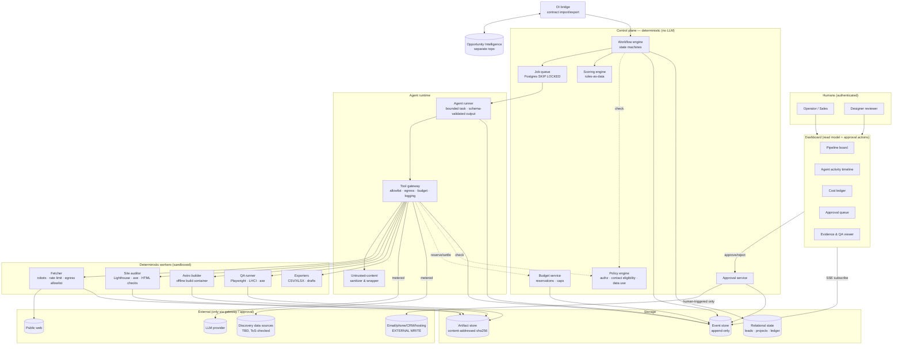
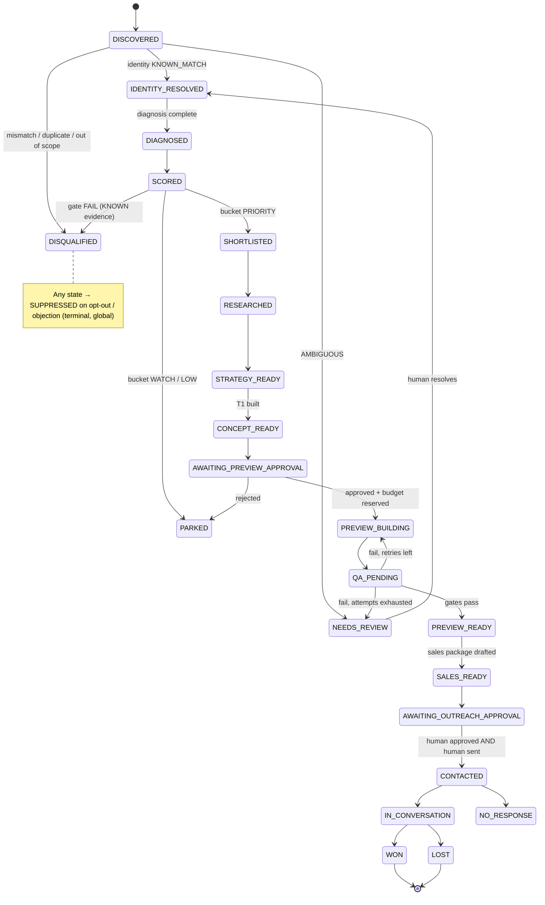

# Web Agency OS — Architecture (Phase 0)

Status: **proposal, not implemented**. Nothing described here exists as code yet.
Date: 2026-10-19. Related: [agent-design](agent-design.md) · [data-contracts](data-contracts.md) ·
[security-and-compliance](security-and-compliance.md) · [quality-gates](quality-gates.md) · [roadmap](roadmap.md) ·
[decisions](decisions.md).

Conventions used in every Phase 0 document:

- **VERIFIED** — checked directly (file read, commit inspected, source cited).
- **ASSUMPTION** — a working hypothesis we act on until disproved; listed in [decisions.md § Assumptions](decisions.md#assumptions).
- **UNKNOWN** — not known; must be resolved before the milestone that depends on it.

---

## 1. Workspace and Git state found (task 1)

| Item | Finding | Status |
|---|---|---|
| `web-agency-os` | Empty Git repository, branch `ccr-ebbba00b-pjvlus`, no commits. Phase 0 adds documentation only. | VERIFIED |
| `aangelrvss-oss/OI` `main` | One commit `cab9f5e` (2026-10-09, "Initial commit") containing only a one-line `README.md` (`# OI`). | VERIFIED |
| `aangelrvss-oss/OI` branch `claude/zealous-archimedes-qb70kr` | **The real implementation.** Head `19aeeb8`, parent `f66f674`, both 2026-10-09. 218 files: Python package `oi/`, `core/`, `rules/`, `cases/`, `tests/`, `docs/`. Self-described as the *public edition*: real pilot data was removed and replaced by labelled synthetic data (`docs/SANITIZATION_REPORT.md`). | VERIFIED |
| OI private copy | Referenced by OI docs (601/601 tests, pilot data, F12–F15.1 suites). Not available to this session. | UNKNOWN — not inspected |
| Local OI workspace | None found on this machine besides the clone made for this audit. | VERIFIED |

How OI was inspected: a read-only clone (`git clone`, then a detached checkout of the branch in the local clone) and static
reading of source, schemas, rules and docs. **No OI code was executed** (the attempt to run its test suite in an isolated
export was blocked by the session's code-execution policy, which is consistent with the Phase 0 constraint). No branch,
commit or remote of OI was modified. The test figures below are therefore OI's *own committed claims*
(`tests/LAST_RUN.json`: 371 run, 0 failures, 15 skipped), **not independently reproduced**.

## 2. Opportunity Intelligence: current architecture (task 2)

### 2.1 What OI is

A contract-driven B2B research engine: natural-language need → validated *Search Spec* → budgeted *Research Plan* →
discovery → entity resolution → cheap gates → enrichment → evidence → qualification → contact selection →
`opportunity_record.v1` → HTML report (ES/EN). Python 3 (tested with 3.13 per README), **standard library only** (static
import scan confirms no third-party imports in `oi/`; `jsonschema` optional in one test).

```
Request → Search Spec → Research Plan → Discovery → Normalize + Entity Resolution → Cheap Gates → Enrichment
        → Qualification / Scoring → Evidence → Results → Approval → Action → Outcome
```

| Stage | Module | OI's own status label |
|---|---|---|
| Spec | `oi/engine/spec/` (local deterministic interpreter, no LLM) | partial / implemented |
| Plan + budget | `oi/engine/planner/` (`budget.py`, `stopping.py`, capabilities) | implemented |
| Discovery/executor | `oi/engine/executor/` + `oi/pipeline/guard.py` — `offline` (synthetic) and `replay` transports; `real` always raises `RealModeBlocked` | partial |
| Entity resolution | `oi/engine/evaluators/` (4-state identity, no fuzzy matching) | implemented |
| Gates/qualification | `oi/qualification/qualifier.py` + `rules/qualification.v1.json` | implemented |
| Evidence | `evidence_input.v1` contract, `oi/evidence/{intake,producers,strength}.py` — **no real first-party evidence producer** | partial |
| Scoring | `oi/rules/d010/` (D010-v0.2, rules-as-data) — **not wired into the pipeline** | partial |
| Project opportunities | `core/project_opportunity.py` v0.1 — pure function, lexicographic priority, not wired to CLI | partial |
| Contact | `oi/enrichment/contact/` with anti-invention checks | partial |
| Approval | `oi/pipeline/approval.py` — offline auto-approval scoped to `DRY_EXECUTION`; real mode unreachable | implemented (offline) |
| Next action | `oi/rules/next_action.py` + `rules/next_action.v1.json` | partial |
| Outcome loop / CRM / sending | — | not implemented |

### 2.2 Reuse assessment

Reuse means **reusing contracts, vocabularies and rule designs**, not importing OI code into Web Agency OS
(see D-001 in [decisions.md](decisions.md#decisions)). Every item below must be re-verified against the OI commit pinned at integration time.

| OI asset | Reuse verdict | Why / caveats |
|---|---|---|
| Truth vocabulary `claim_status` = `KNOWN · INFERRED · ESTIMATED · UNKNOWN · CONFLICTING` and the rule "UNKNOWN ≠ PASS, INFERRED ≠ KNOWN" (`common.v1.schema.json`) | **Adopt verbatim** | Exactly what WAOS needs for website findings and business facts. Shared vocabulary makes the bridge lossless. |
| `source_class` = `OFFICIAL · PROFESSIONAL_DIRECTORY · SECTOR_SOURCE · OTHER_VERIFIABLE · UNVERIFIED · NOT_FOUND` | **Adopt + extend** | WAOS adds `MEASUREMENT` (our own reproducible test, e.g. Lighthouse) and `PUBLIC_REGISTRY` (`core/` already uses `PUBLIC_OFFICIAL`; the two OI vocabularies are not identical — **must be reconciled**, see §2.3). |
| `evidence_input.v1` (evidence_id, subject, field, value, source_class, claim_status, confidence, retrieved_at, source_url, snippet-like note, data_mode, evidence_origin) | **Adopt as the exchange format** | WAOS `EvidenceRecord` is a superset; a lossless projection to `evidence_input.v1` is defined in [data-contracts § 3](data-contracts.md#3-evidencerecord). |
| `rules/evidence_strength.v1.json` (ordered rules, first match wins; strength = data reliability, *not* commercial usefulness) | **Adopt design**, copy rules into WAOS rules-as-data | Separating "reliability of the datum" from "usefulness of the lead" is the key idea. |
| `core/project_opportunity.validate()` rules: KNOWN requires URL + literal snippet; never from a search-result snippet; emails must appear literally in the cited snippet; inference never KNOWN | **Adopt as evidence invariants** | Directly applicable to business research and contact points. |
| Contact anti-invention checks (`oi/enrichment/contact/checks.py`): no channel without backing evidence; no pattern-built emails; quality derived, not assigned | **Adopt rules** | Required by the compliance model (no invented contact data). |
| Budget model (`oi/engine/planner/budget.py`): no budget → `BUDGET_REQUIRED`; calls, credits and time are separate dimensions; reserve %; credits only from *observed* costs; hard cap ≠ authorization | **Adopt rules**, reimplement | Matches [§7 budget rules](#7-budget-control-rules). Apollo-specific fields are not reused. |
| `guard.py` pattern: single egress module; offline socket lock that counts and blocks connections; operation allowlists; real mode blocked by two independent switches | **Adopt pattern** | Becomes the WAOS Tool Gateway + test-time network lock. |
| `ToolCallLedger` fields (`credit_before/after`, `estimated_cost`, `actual_cost`, `input_hash`, `data_origin`…) | **Adopt fields** | Basis of the WAOS cost ledger. |
| Rules-as-data with versioning + hash (`d010/rules.json`, `rules_hash`) and "score is not a probability, `calibrated=false`" | **Adopt design** | WAOS scoring rules follow the same discipline. |
| D010 unit IDs (`F1`, `FIT_KW`, `T1`, `P1`, `O2`…) | **Do not reuse** | Specific to the reseller pilot. |
| Search Spec v1/v2, spec interpreter, planner field routing | **Do not reuse now** | Built for firmographic B2B search, not "local business with a website problem". Revisit if WAOS uses OI for discovery. |
| Apollo adapter / paid enrichment ops | **Do not reuse** | Paid provider; contact data from a data broker conflicts with the WAOS contact-eligibility model. |
| HTML renderer | Not needed | WAOS has its own dashboard. |

**Pilot learnings worth carrying over** (OI README, aggregate figures only, not reproducible from the public edition):
provider-based discovery was noisy for a niche (provisional precision 1/9 in the construction pilot); the measured
bottleneck was **first-party evidence production**, done manually with free web search; human-pre-reviewed candidates
performed better (58.8 % vs 22.2 % "yes", small non-random sample). Implication for WAOS: invest in a reliable
first-party *website diagnosis* evidence producer before anything generative — which is also the piece OI lacks.

### 2.3 Inconsistencies found in OI (must be resolved before integration)

1. Two `source_class` vocabularies: `common.v1.schema.json` (6 values) vs `core/project_opportunity.py` (8 values, adds
   `PUBLIC_OFFICIAL`, `HUMAN_REVIEW`). WAOS will map both explicitly; OI should converge (an OI change — out of Phase 0 scope).
2. `main` contains no code; the implementation lives on an unmerged branch. Integration must pin a **commit SHA**, not a branch.
3. D010 and `core/project_opportunity` are not connected to OI's pipeline; OI's output order is `discovery_rank`.
4. OI has no LLM integration and no real transport; "LLM proposes, code decides" is a protocol, not yet enforced code.

## 3. Proposed Web Agency OS architecture (task 3)

### 3.1 Principles

1. **Deterministic control plane, probabilistic workers.** Agents (LLM calls) *propose*; application code validates,
   authorizes, budgets and transitions state. No agent can change workflow state, spend, or write externally.
2. **Evidence before generation.** Every claim about a business or its website is an `EvidenceRecord` with a source and a
   truth state. Expensive generation is reserved for leads whose evidence and score clear explicit gates.
3. **Event-sourced observability.** Every task, tool call, cost, error and approval is an immutable event. The dashboard
   only renders events that happened — no simulated activity.
4. **Independent from OI.** Integration by versioned JSON contracts and file/HTTP exchange, never by importing each
   other's code or sharing a database.
5. **Least privilege.** Agents have no shell, no filesystem, no raw network. They call typed tools through a gateway that
   enforces per-agent allowlists, egress policy and budget reservations.
6. **Untrusted input stays data.** Website content, search results and documents are never interpreted as instructions.
7. **Human approval for anything outward-facing or above budget.**

### 3.2 Component diagram



Text fallback:

```
Humans ──► Dashboard ──(approve)──► Approval svc ──(human-triggered)──► External writes
              ▲ SSE
              │
          Event store ◄── every component emits events
              ▲
Workflow engine (state machines) ──► Job queue ──► Agent runner ──► Tool gateway ──► Workers / LLM / Public web
      │  ▲                                                     │  ├─ policy check (Policy engine)
      │  └── Scoring engine (rules-as-data)                    │  └─ reserve/settle (Budget service)
      └── OI bridge ◄──► OI (separate repo, JSON contracts)    └─ untrusted content → sanitizer → agent (as data)
```

### 3.3 Component responsibilities

| Component | Responsibility | Deterministic? |
|---|---|---|
| Workflow engine | Owns lead and website-project state machines (§4). Only component that writes state. Transitions require guard predicates (evidence present, score ≥ threshold, approval granted, budget available). | Yes |
| Policy engine | Evaluates rules: which agent may call which tool with which arguments; contact eligibility; data retention; whether an action needs approval. Policies are versioned data. | Yes |
| Budget service | Hierarchical caps (global → campaign → stage → task). Reserve-before-call, settle-after-call. Denies rather than truncates. | Yes |
| Approval service | Creates `ApprovalRequest`s, records human decisions with identity and timestamp, executes approved external writes *once* (idempotency key). | Yes |
| Scoring engine | Computes eligibility, priority bucket and score from evidence using versioned rules. No LLM. | Yes |
| Job queue | Durable tasks with retries, leases, idempotency keys, dead-letter. Postgres `FOR UPDATE SKIP LOCKED` (no extra broker in M1). | Yes |
| Agent runner | Executes one bounded agent task: builds prompt from task spec, calls LLM through gateway, validates output against JSON Schema, emits events. Max turns, max tokens, max tool calls per task. | Orchestration yes; model output no |
| Tool gateway | Single egress point (OI `guard.py` pattern). Per-agent allowlist, argument validation, egress domain policy, rate limits, budget reservation, full call logging with input hash. | Yes |
| Sanitizer | Converts fetched HTML to text + structure, strips scripts/hidden text, records what was removed, wraps content as quoted untrusted data with provenance. | Yes |
| Fetcher | HTTP + headless render in sandbox; robots.txt honoured; per-domain rate limit; identifies itself with a contact User-Agent; stores raw capture by hash. | Yes |
| Site auditor | Runs reproducible measurements on prospect sites (Lighthouse, axe, TLS, mobile viewport, HTML checks). Produces `Measurement` evidence. | Yes |
| Astro builder | Renders a validated `WebsiteProjectManifest` with a pinned component library in an offline container. Agents never write arbitrary code (M1–M7). | Yes |
| QA runner | Executes [quality gates](quality-gates.md). | Yes |
| OI bridge | Imports/exports OI contracts (`evidence_input.v1`, `opportunity_record.v1`) with schema validation against a vendored, hash-pinned copy of OI's schemas. | Yes |
| Dashboard | Read model projected from events; approval actions; no direct DB writes. | Yes |

### 3.4 Technology baseline (proposal — see [decisions.md](decisions.md))

| Concern | Choice | Status |
|---|---|---|
| Control plane language | Python 3.12+ (same as OI; strong typing via Pydantic or dataclasses + JSON Schema) | Proposed, D-010 |
| State + events + queue | PostgreSQL (SQLite allowed for local M1 tests) | Proposed, D-011 |
| Build/QA toolchain | Node.js ≥ 22.22 worker: Astro (≥ 7.2.8, latest 7.4.x), Playwright 1.64.x, Lighthouse 13.x via Node API (not Lighthouse CI — stale), axe-core 4.14 — in a separate sandboxed container image with lockfile | Proposed, pending admission checks (D-012, [dependency assessment](decisions.md#dependency-assessment)) |
| Agent framework | In-house thin runner first behind an `AgentRuntime` interface; AgentScope 2.0.x evaluated in an isolated spike (never 1.x: 2026 advisories ≤ 1.0.18) | D-005 |
| LLM provider | **UNKNOWN** — to be selected; cost tables in roadmap stay empty until then | Open |
| Discovery data source | **UNKNOWN** — candidates must pass ToS/licence review (see security doc) | Open |
| Hosting (previews, production) | **UNKNOWN** — previews private by default | Open |

### 3.5 Interface to OI (explicit contract, no coupling)

```
            WAOS                                    OI
 ┌───────────────────────────┐          ┌──────────────────────────┐
 │ EvidenceRecord (superset) │──export─►│ evidence_input.v1        │  WAOS website diagnosis = the
 │                           │          │ (OI lacks a first-party  │  first-party evidence producer
 │                           │          │  web producer)           │  OI is missing
 │ Lead import               │◄─import──│ opportunity_record.v1    │  OI-qualified companies can enter
 └───────────────────────────┘          └──────────────────────────┘  WAOS as leads (source = OI)
```

Rules: (1) exchange is files or HTTP with JSON documents validated on both sides; (2) WAOS vendors OI schemas into
`contracts/vendor/oi/<commit-sha>/` with a SHA-256 manifest and a test that fails if they drift; (3) no shared database,
no Python import of `oi.*`; (4) truth states map 1:1, `source_class` maps through an explicit table, unknown values are
rejected (never coerced); (5) WAOS data with `data_mode=REAL` is never written into OI's public repository.

## 4. Business workflow (task 4)

### 4.1 Stages

| # | Stage | Main question | Who does the work | Cost class | Output |
|---|---|---|---|---|---|
| 1 | Discovery | Which local businesses exist in the target area/category? | Discovery planner agent proposes queries; deterministic collectors execute | Low | `Lead` (status `DISCOVERED`) |
| 2 | Identity resolution | Is this one real, active business with a stable key (domain / registry id / normalized name+address)? | Deterministic, OI-style 4-state identity | Very low | `KNOWN_MATCH / AMBIGUOUS / …` |
| 3 | Diagnosis | Does its web presence have *objectively verifiable* problems? | Site auditor (deterministic) + diagnostician agent writes summary that must cite measurement IDs | Low | `WebsiteDiagnosis` + `Finding[]` |
| 4 | Scoring | How strong and how valuable is the opportunity, and how sure are we? | Scoring engine (no LLM) | ~0 | `ScoreRecord`, bucket |
| 5 | Research | What does the business do, for whom, where; what proof exists? | Research agent reading the business's own pages + allowlisted public sources | Medium | `ResearchDossier` (claims → evidence) |
| 6 | Website strategy | Which scope fits (tier, pages, goals, CTA)? | Strategist agent; rules cap scope by tier | Medium | `WebsiteStrategy` |
| 7 | Creative assets | Visual direction, copy, imagery with provenance | Creative agent within an approved design system and licensed asset library | Medium–High | `CreativeBrief`, `AssetRecord[]` |
| 8 | Generation | Build a preview | Builder agent fills the manifest; deterministic Astro build | Medium | `WebsiteProjectManifest`, build artifact |
| 9 | QA | Does it pass measurable gates? | QA runner + advisory reviewer agent + human design review | Low–Medium | `QAReport` |
| 10 | Sales preparation | Diagnostic report, proposal, outreach draft | Sales-prep agent; nothing is sent | Low | `SalesPackage` (drafts) |
| 11 | CRM | Track contacts, responses, outcomes, suppression | Deterministic CRM module; human logs outcomes | ~0 | `PipelineEvent`s |
| 12 | Delivery | Signed client → full site, content collection, publication, handover | Human-led with agent assistance; publication requires approval | High (paid by client) | Production site, handover pack |

### 4.2 Generation tiers — "do not build a website for every lead"

| Tier | Artifact | Entry condition (all required) | Approx. relative cost |
|---|---|---|---|
| T0 | Diagnosis summary (internal) | `IDENTITY=KNOWN_MATCH`, in target geography/category | 1× |
| T1 | Concept card: hero mock-up + palette + 3 copy lines (static image/HTML, one screen) | Bucket `PRIORITY` (implies confidence band `STRONG`/`MODERATE` and an eligible contact channel), not suppressed | ~5× |
| T2 | One-page private preview (Astro, real content from research, placeholders marked) | T1 done + **human approval** + campaign T2 quota not exhausted + per-lead budget envelope available | ~20–40× |
| T3 | Full multi-page site | Signed engagement (out of the automated sales funnel) | client project |

Quotas are policy data, e.g. "max 10 T2 previews per campaign per week" — exact values set by the user.

### 4.3 Lead state machine



Global rules: any state → `SUPPRESSED` on opt-out, objection or erasure request (terminal; contact data minimized to a
suppression hash). Any state → `ON_HOLD` via kill switch. Re-entry from `PARKED` only when new evidence arrives or after a
configured re-check interval.

### 4.4 Website project state machine (post-sale, T3)

`CONTRACTED → CONTENT_COLLECTION → BUILD → QA → CLIENT_REVIEW → (revisions loop) → AWAITING_PUBLISH_APPROVAL →
PUBLISHED → HANDOVER → MAINTENANCE|CLOSED`. Publication requires client sign-off **and** internal approval;
both recorded as `ApprovalRequest`s.

## 5. Data flow

```
 Public sources ─► Fetcher ─► raw capture (sha256, AS) ─► Sanitizer ─► extracted text + structure
                                                             │
                     Site auditor ─► Measurements ───────────┤
                                                             ▼
                                                     EvidenceRecord[] (claim_status, source_class, snippet, capture hash)
                                                             │
                                Scoring engine ◄─────────────┤
                                     │                       │
                                 ScoreRecord                 ▼
                                     │               ResearchDossier ─► WebsiteStrategy ─► CreativeBrief
                                     ▼                                                       │
                              Workflow guards ─► (approval) ─► WebsiteProjectManifest ─► Astro build ─► QA ─► QAReport
                                                                                                         │
                                                                    SalesPackage (drafts only) ◄─────────┘
                                                                           │
                                                          Approval ─► human sends ─► CRM events ─► outcome
```

Every arrow writes an event; every artifact is content-addressed; every claim shown to a human or placed on a preview
links to an `evidence_id` or is explicitly marked as a placeholder.

## 6. Failure and retry strategy

| Failure class | Examples | Handling |
|---|---|---|
| Transient | timeout, 5xx, connection reset | Retry with exponential backoff + full jitter (base 2 s, factor 2, max 3 attempts); same idempotency key. |
| Rate limited | HTTP 429, provider quota | Honour `Retry-After`; per-provider token bucket; does **not** consume retry attempts; circuit breaker opens after N consecutive 429s. |
| Permanent input | 404, DNS NXDOMAIN, robots disallow, invalid URL | No retry. Record as evidence (`NOT_FOUND` / `BLOCKED_BY_ROBOTS`), which may itself be a valid finding. |
| Policy denied | tool not allowed, egress blocked, approval missing | No retry. Task → `BLOCKED_POLICY`; surfaced in dashboard. Repeated denials for the same agent → alert (possible prompt injection). |
| Budget | reservation exceeds remaining | No retry. Task → `BLOCKED_BUDGET`; approval request for a raised cap. Never auto-raised. |
| Invalid model output | JSON schema violation, missing evidence refs | One repair attempt with the validator's error list; then `FAILED_NEEDS_HUMAN`. Repair attempts count against the task budget. |
| Quality gate fail | Lighthouse below threshold, axe violations | Up to 2 regeneration attempts with the gate report as input; then `NEEDS_REVIEW`. |
| Worker crash / lease expiry | container OOM, node lost | Lease timeout returns job to queue; handler idempotent; attempt count persists; poison jobs → dead-letter after 3. |
| Data inconsistency | conflicting facts, ledger mismatch with provider balance | Never auto-resolved: claim → `CONFLICTING`; ledger mismatch → **halt all paid calls** for that provider (OI pilot practice). |

Checkpointing: each stage persists its output before the transition event; resumption restarts the failed step only.
Circuit breakers per external provider (open after 5 consecutive failures, half-open after 5 min). A global kill switch
stops new task leasing and denies all gateway calls within one polling interval.

## 7. Budget-control rules

Adapted from OI's planner and pilot practice; enforced by the Budget service and Tool gateway, never by agents.

| ID | Rule |
|---|---|
| B1 | No budget, no run: a campaign without an explicit budget cannot start (`BUDGET_REQUIRED`). |
| B2 | Separate dimensions: `llm_cost_eur`, `paid_api_cost_eur` per provider, `provider_credits` per provider, `compute_minutes`, `wall_clock_minutes`, and count quotas (`max_leads_diagnosed`, `max_t1`, `max_t2`). One cannot be converted into another. |
| B3 | Hierarchy: global monthly cap ≥ campaign cap ≥ stage cap ≥ per-lead envelope ≥ per-task envelope. A call must fit every level. |
| B4 | Reserve-then-settle: before each metered call the gateway reserves the *maximum* possible cost (e.g. max tokens × price); after the call it settles the actual cost and releases the remainder. |
| B5 | Deny, don't truncate: if the reservation does not fit, the call is not made. |
| B6 | Unknown cost = blocked in autonomous mode. A tool without an observed or contractual unit price can only run with a per-call human approval. |
| B7 | A hard cap is not an authorization; account balance is not a budget. |
| B8 | Reserve: 10 % (configurable) of each campaign budget is held back for retries/repairs. |
| B9 | Alerts at 50 %, 80 %, 100 %; at 100 % the scope blocks. Raising a cap is an approval with a new explicit number. |
| B10 | Reconciliation: where a provider exposes balance/usage, read before and after paid batches; a mismatch above tolerance halts that provider. |
| B11 | Expensive stages are gated by score and evidence (tiers §4.2), and by count quotas, not only by money. |
| B12 | All prices live in a versioned `pricing.v1.json` with source and date; estimates cite the pricing version used. |

## 8. Security architecture summary

Details in [security-and-compliance.md](security-and-compliance.md). Structural measures:

- Agents run with **no** shell, filesystem, or socket access; only typed tools via the gateway.
- Agents that read untrusted content have **no** external-write tools and no access to secrets — breaking the
  "untrusted input + private data + exfiltration channel" combination.
- Workers (fetch, audit, build, QA) run in containers with read-only root FS, no credentials, dropped capabilities,
  CPU/memory/time limits, and egress restricted per worker type (builder: none at build time).
- Secrets live in a secret manager / environment of the gateway process only; never in prompts, artifacts or events.
- External writes exist only in the Approval service and execute only after a recorded human decision.

## 9. Visual dashboard specification (task 6)

The dashboard is a **projection of the event store**. It shows only what happened. If a component emitted no event, the
UI shows nothing for it.

### 9.1 Event model (minimum)

Every event: `event_id` (ULID), `ts`, `type`, `run_id`, `task_id?`, `lead_id?`, `project_id?`, `actor`
(`system | agent:<name>@<version> | human:<user_id>`), `payload` (schema per type), `cost?`, `causation_id`,
`correlation_id`. Types:

`task.queued · task.leased · task.started · task.completed · task.failed · task.retry_scheduled · task.blocked`
`agent.prompt_built (hash + token count, not full text by default) · agent.output (validated summary) · agent.output_rejected`
`tool.call_requested · tool.call_denied (reason) · tool.call_completed (status, duration, cost, input_hash, result_ref)`
`source.fetched (url, status, robots decision, capture sha256)` · `evidence.recorded` · `finding.recorded`
`budget.reserved · budget.settled · budget.threshold_crossed · budget.blocked`
`approval.requested · approval.granted · approval.rejected · approval.expired`
`state.transitioned (from, to, guard results)` · `qa.gate_result` · `policy.violation` · `system.kill_switch`

Optional export of agent/tool spans using OpenTelemetry GenAI semantic conventions (still *Development* status as of
2026-10, medium confidence), so third-party viewers can be evaluated without becoming the source of truth. Note: the
standalone AgentScope Studio repository is archived; AgentScope 2.0 ships its own Web UI and an Agent Service that streams
session events over SSE. If the AgentScope spike (D-005) is adopted, its events are mirrored *into* this event store — its
UI is never the system of record.

### 9.2 Views

| View | Shows | Interactions |
|---|---|---|
| **Pipeline board** | Leads as cards in columns by state; counts and conversion between stages; filters by campaign, category, area, bucket | Open lead; no drag-to-transition (transitions are guarded by the workflow engine) |
| **Live agent activity** | One lane per active task: agent name/version, task type, lead, elapsed time, current tool call, tokens/cost so far, retries | Expand to full event timeline; open prompt/output (permission-gated); cancel task |
| **Task timeline (per run/lead)** | Ordered events with causation tree: task → tool calls → sources → evidence → outputs → transitions | Jump to artifact, evidence, capture |
| **Sources & evidence** | URL, fetch time, robots decision, capture hash, literal snippet, claim status, source class, strength; conflicts highlighted | View sanitized capture; mark evidence reviewed (creates `HUMAN_REVIEW` evidence) |
| **Outputs** | Diagnoses, dossiers, strategies, manifests, screenshots of previews at 4 viewports, QA reports | Diff between versions |
| **Costs** | Spend by campaign / stage / agent / provider / lead vs caps; reservations open; forecast at current burn; pricing version | Request cap change (creates approval) |
| **Errors & dead letters** | Failures grouped by class (§6), provider circuit-breaker state, policy denials (security signal) | Retry (if retryable), discard with reason |
| **Approval queue** | Pending requests: type, what exactly will happen (rendered diff / message text / URL / amount), evidence summary, policy check results, expiry | Approve / reject with comment; four-eyes for publication and outbound if configured |
| **Compliance** | Contact eligibility per lead, suppression list size (hashes), retention jobs, robots/ToS blocks | Process opt-out / erasure |

Non-functional: live updates via Server-Sent Events from the event store (≤ 2 s lag target); role-based access (viewer,
operator, approver, admin); every approval action authenticated and written as an event; prompts and raw captures hidden
by default (may contain personal data).

## 10. Open items carried to the roadmap

LLM provider, discovery source(s), hosting for previews, CRM/spreadsheet target (Google Sheets vs internal + export),
Spanish legal review of the outreach channel, AgentScope spike result. See [roadmap.md](roadmap.md).
